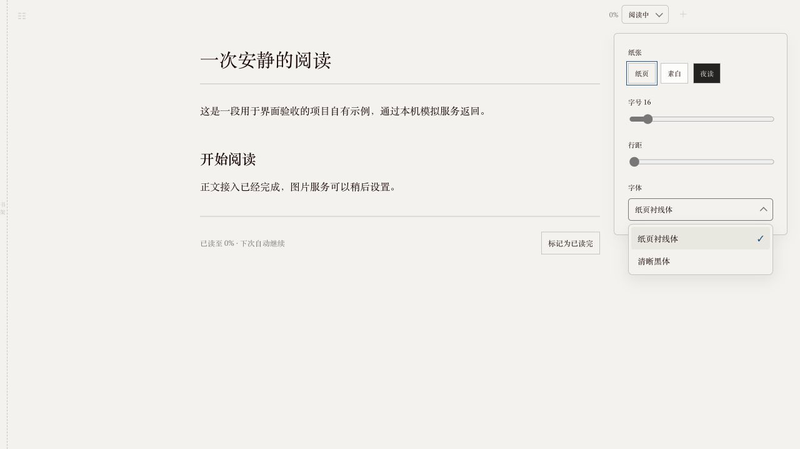

# Quiet Reader (拾页)

English · [中文](README.md)

Drop in a foreign-language article, get it in your language, and read it quietly.



The interface is in Chinese for now; the target language is a separate picker
("译为") next to the import button.

## Highlights

- **Figures get translated too.** A vision model reads a chart's structure and
  local code redraws it as SVG in the target language, keeping colors,
  proportions and connectors. Photos stay as they are; switch back to the
  original at any time.
- **Local-first.** Runs on your machine; articles, translations and reading
  progress stay on disk. No account, no telemetry.
- **Bring your own model.** Any Chat Completions-compatible service, cloud or
  local. No provider is preset.
- **Long articles survive interruptions.** Translated and saved chunk by chunk;
  timeouts and rate limits are retried, and a failed run resumes where it
  stopped instead of paying again.
- **One-click import.** Paste a link or Markdown, or click the Chrome/Edge
  extension on any article. The extension sends only the URL, never page text
  or cookies.
- **Made for reading.** Translated, original and side-by-side modes, outline,
  fullscreen and paper themes, with a separate reading position per mode.

## Let an agent install it

Give this to a coding agent such as Claude Code or Codex:

```text
Install and run Quiet Reader locally: https://github.com/xsk-code/quiet-reader
1. After cloning, read AGENTS.md at the repository root and follow its steps.
2. Node.js 22+ is required. Run npm ci, then npm run doctor -- --json to confirm the install is healthy.
3. Run npm start in a long-running terminal. If the port is taken, set PORT; never kill other processes.
4. Once /api/health responds, tell me the reader URL.
5. I will enter the model key myself under "模型接入" (model setup). Do not ask me for it or put it in chat or the repository.
```

To install by hand, configure providers or troubleshoot, see
[the install guide](docs/INSTALL.md) (Chinese) or
[agent deployment](docs/AGENT_DEPLOY.md) (English).

## Docs

- [Install](docs/INSTALL.md) · [Providers](docs/PROVIDERS.md) · [Extension](docs/EXTENSION.md)
- [Agent deployment](docs/AGENT_DEPLOY.md) · [Architecture and API](docs/ARCHITECTURE.md) · [Compatibility](docs/COMPATIBILITY.md)
- [Security](SECURITY.md) · [Contributing](CONTRIBUTING.md) · [Changelog](CHANGELOG.md)

## Acknowledgements

Reading X posts relies on the public API of
[FxEmbed / FxTwitter](https://github.com/FxEmbed/FxEmbed) (MIT, dangered wolf and
contributors). Article extraction uses
[Mozilla Readability](https://github.com/mozilla/readability); Markdown
conversion uses [Turndown](https://github.com/mixmark-io/turndown); parsing and
rendering use [jsdom](https://github.com/jsdom/jsdom),
[Marked](https://github.com/markedjs/marked) and
[DOMPurify](https://github.com/cure53/DOMPurify). Body text is set in PT Serif
by ParaType.

## License

Project code is [MIT](LICENSE). PT Serif is SIL OFL 1.1 and dependencies keep
their own licenses; see [THIRD_PARTY_NOTICES.md](THIRD_PARTY_NOTICES.md). The
license does not cover third-party articles you import.
