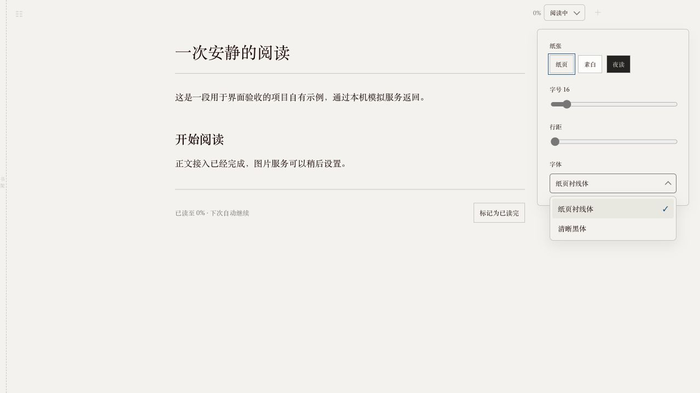

# 拾页 · Quiet Reader

[English](README.en.md) · 中文

把外文文章放进来，译成你的语言，安静地读完。



## 特色

- **图也一起翻译。** 视觉模型识别图表结构，本机代码按目标语言重绘成 SVG，保留原图的配色、比例和连线；照片保持原样，随时切回原图核对。
- **本地优先。** 只运行在你的电脑上，文章、译文和阅读进度都存在本机；不需要注册账号，没有遥测。
- **模型自己选。** 接入任何兼容 Chat Completions 的服务，云端或本机模型都可以，项目不预设服务商。
- **长文不怕断。** 按段翻译、逐段保存；断线或限流自动重试，失败后从断点继续，不重复计费。
- **一键导入。** 粘贴链接或 Markdown，或用 Chrome / Edge 插件在任意文章页点一下导入；插件只交出网址，不读取正文或 Cookie。
- **为阅读而设计。** 译文、原文、双语对照三种模式，目录、全屏、纸张主题，每种模式各自记住阅读位置。

## 让 Agent 帮你安装

把下面这段话交给 Claude Code、Codex 等编程 Agent：

```text
请在本机安装并运行「拾页 Quiet Reader」：https://github.com/xsk-code/quiet-reader
1. 克隆仓库后先阅读根目录的 AGENTS.md，按其中步骤安装和检查。
2. 需要 Node.js 22+；运行 npm ci，再用 npm run doctor -- --json 确认安装健康。
3. 在常驻终端运行 npm start；端口被占用时换 PORT，不要结束其他进程。
4. 确认 /api/health 正常后，把阅读页地址告诉我。
5. 模型密钥由我自己在页面「模型接入」里填写，不要向我索要，也不要写进聊天或仓库。
```

想自己动手，或需要配置、排错，请看 [安装说明](docs/INSTALL.md)。

## 文档

- [安装、配置与排错](docs/INSTALL.md) · [模型服务配置](docs/PROVIDERS.md) · [浏览器插件](docs/EXTENSION.md)
- [Agent 部署](docs/AGENT_DEPLOY.md) · [架构与接口](docs/ARCHITECTURE.md) · [兼容性记录](docs/COMPATIBILITY.md)
- [安全策略](SECURITY.md) · [贡献指南](CONTRIBUTING.md) · [更新记录](CHANGELOG.md)

## 致谢

X 帖子与长文的读取依赖 [FxEmbed / FxTwitter](https://github.com/FxEmbed/FxEmbed)（MIT，作者 dangered wolf 与贡献者）提供的公开接口；正文提取使用 [Mozilla Readability](https://github.com/mozilla/readability)，Markdown 转换使用 [Turndown](https://github.com/mixmark-io/turndown)，渲染与解析使用 [jsdom](https://github.com/jsdom/jsdom)、[Marked](https://github.com/markedjs/marked) 和 [DOMPurify](https://github.com/cure53/DOMPurify)；正文字体为 ParaType 的 PT Serif。

## 许可

项目代码使用 [MIT](LICENSE)。PT Serif 使用 SIL OFL 1.1，依赖保留各自许可，见 [第三方资源说明](THIRD_PARTY_NOTICES.md)。项目许可不覆盖你导入的第三方文章内容。
