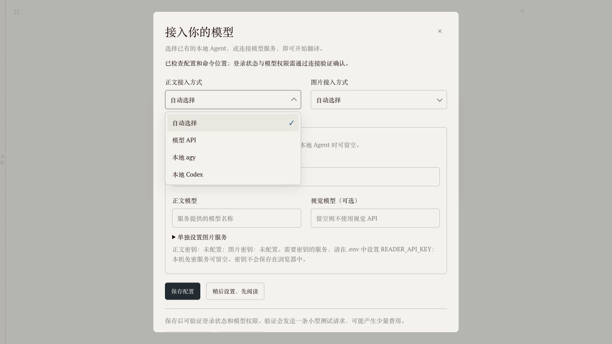

# 安装、配置与排错

## 最短流程

```sh
node --version
npm --version
npm ci
npm run doctor -- --json
npm start
```

需要 Node.js 22+。安装健康时 `doctor` 退出 0；正文接入未配置时 `ready: false`，仍可启动页面完成配置。要把模型配置也作为门禁，运行 `npm run doctor -- --require-model`。

先用 `npm run demo` 可以在没有密钥的情况下看完整阅读流程；`npm run verify` 用临时目录和本地模拟服务做无头安装验证。默认地址 <http://127.0.0.1:4317>；`npm run start:open` 可打开浏览器。测试内容可使用 `examples/sample.md`。

macOS 的 `启动拾页.command` 检查 Node 版本、安装缺少的依赖，再调用同一启动流程。它复用同目录已运行的服务，不自动重启。Linux、Windows 可使用 npm 命令。

### 一键导入插件

在 Chrome 或 Edge 中加载项目里的 `extension/` 目录后，可在任意文章页点扩展图标，直接把当前网址交给本机拾页并跳到阅读页；也支持右键页面/链接。安装步骤、权限和排错见 [浏览器插件](EXTENSION.md)。插件只提交页面网址，不读取正文、Cookie 或登录状态；Safari 不支持该扩展，可改用文档里的书签方案。

### Windows

Windows 的 API-only 流程由 CI 覆盖：`npm ci`、`npm test`、`npm run verify`、`npm start`、`/api/health` 和示例导入。打开 <http://127.0.0.1:4317>（不要用 `localhost`，它可能先解析到 IPv6）。PowerShell 示例：

```powershell
npm ci
$env:READER_TEXT_PROVIDER="api"
$env:READER_API_BASE_URL="https://你的服务地址/v1"
$env:READER_TEXT_MODEL="你的模型名"
$env:READER_DATA_DIR="$PWD\data"
npm run doctor -- --json
npm start
```

Windows 暂不支持通过 npm 的 `.cmd`/`.bat` 包装启动本地 agy/Codex；请使用 API 接入。若 `AGY_BIN`/`CODEX_BIN` 指向原生可执行文件，可自行验证，但本项目目前不把它作为支持项。

## 直接连接模型服务

1. 在“模型接入”中将正文设为“模型 API”。
2. 填写支持 Chat Completions 的基础地址和服务商提供的模型名。应用追加 `/chat/completions`，所以不要重复填写。支持 HTTPS 及本机 HTTP，例如 `http://127.0.0.1:11434/v1`；不是所有服务和模型都兼容。常见服务示例见 [模型服务配置](PROVIDERS.md)，项目不预设服务商。
3. 需要密钥时，可直接在页面填写（保存到本机 `data/secrets.json`，0600，不回显），或在根目录创建 `.env`。环境变量优先；不要把密钥放进聊天或服务网址。
4. 修改 `.env` 后重启；页面保存的地址、模型和密钥无需重启。
5. 可点击“获取模型”读取 `/models` 列表；不支持该接口时手动填写模型名。保存后点击“验证正文连接”，确认实际登录和模型权限。验证发送小型请求，可能计费。



视觉模型可以使用相同或独立的服务；独立图片服务使用自己的 `READER_IMAGE_API_KEY`。只有相同地址才会复用正文密钥；不同图片地址不会收到正文密钥。没有视觉模型时选“保留原图”；稍后配置完成可对已有文章单独重绘。

密钥示例仅表示变量名，不含有效凭证：

```dotenv
READER_API_KEY=在本机填写你的密钥
# 仅单独使用其他图片服务时填写：
# READER_IMAGE_API_KEY=该服务自己的密钥
```

也可由系统或进程管理器提供变量；请限制本地环境文件的访问权限。

## 使用已有本地 Agent

本地 Agent 不在配置页面出现，需要通过环境变量接入：在 `.env` 设置 `READER_TEXT_PROVIDER=agy` 或 `codex`，图片需要时再设置 `READER_IMAGE_PROVIDER=agy`。安装并登录对应 CLI，确保命令能从启动拾页的终端执行；必要时使用 `AGY_BIN`、`CODEX_BIN` 指定路径。检测到多个可用接入时，导入区会出现 API/agy/Codex 选择；只有一个可用时自动隐藏。

应用只检查命令位置，不读取账号或凭证文件；实际登录和模型权限需连接验证。agy 正文使用 `gemini-3.8-flash-low`，视觉使用 `gemini-3.8-flash-high`；Codex 当前只接正文。可用性取决于安装版本、账号和服务状态。Windows 上本地 CLI 不是支持项，请使用 API 接入。

## 配置参考

非空环境变量覆盖页面配置。非秘密配置保存在数据目录的 `settings.json`，环境文件位于项目根目录的 `.env`。

| 变量 | 用途／默认值 |
| --- | --- |
| READER_TEXT_PROVIDER | api / agy / codex；默认 api（需填写地址和模型） |
| READER_IMAGE_PROVIDER | api / agy / none；默认 api（沿用正文模型） |
| READER_API_BASE_URL | 正文服务基础地址 |
| READER_TEXT_MODEL | 正文模型名 |
| READER_IMAGE_MODEL | 视觉模型名 |
| READER_IMAGE_API_BASE_URL | 图片服务地址；空时沿用正文地址 |
| READER_API_KEY | 正文／默认服务密钥 |
| READER_IMAGE_API_KEY | 独立图片服务密钥 |
| IMAGE_CONCURRENCY | 默认 2，范围 1–4；限流时可设为 1 |
| PORT | 默认 4317 |
| READER_DATA_DIR | 默认项目下的 data；相对路径按启动工作目录解析 |
| AGY_BIN / CODEX_BIN | 命令路径，默认从 PATH 查找 |

正文接入必须显式选择：模型 API，或本机已安装并登录的 agy/Codex；没有任何可用接入时不能导入新文章，不会自动回退；检测到本地 Agent 时可直接在导入区选择。图片默认沿用正文 API 的多模态模型；可在高级项改为独立视觉 API、`agy` 或 `none` 保留原图。

## 检查与验收

```sh
npm run doctor
npm run doctor -- --json
npm run doctor -- --require-model
# 明确需要实际请求模型时：
npm run doctor -- --probe
```

默认检查不请求模型，也不证明已登录。`ok` 表示安装健康，`ready` 表示正文接入已配置；未配置只算设置项，不算安装错误。`--require-model` 会把未配置变成错误；`--probe` 会发送小型请求。图片不可用是 warning。`modelRequestsSent` 是实际连接验证的数量。

启动后核对 `/api/health`：`application` 为 `shiye`，`version` 与 `package.json` 一致，`projectDirectory` 为当前目录，`textReady`/`imageReady` 表示配置就绪。`/api/status` 额外返回正文任务数、图片并发数、处理中与排队数。API 错误带 `code`，例如 `MODEL_NOT_CONFIGURED`（409）、`IMAGE_RATE_LIMIT`（429）、`MODEL_HTTP`（502）。`/api/setup` 返回配置摘要和静态能力，不返回密钥。

先翻译一段示例正文，视觉接入可用后再验收图片替换和原图切换。`npm test` 和 `npm run verify` 在临时目录中使用本地模拟服务验证完整 API-only 链路，无需真实凭证。

## 常见问题

| 现象 | 处理 |
| --- | --- |
| 正文接入未配置 | 页面保存 API 地址/模型，或按“使用已有本地 Agent”设置环境变量 |
| 找不到命令 | 核对同一个启动终端的 PATH，或设置 BIN 变量 |
| 401 / 403 | 检查密钥和模型权限；环境变量密钥变更后重启，页面密钥即时生效 |
| 清除页面保存的密钥 | 用新密钥覆盖；或停止服务后删除数据目录的 `secrets.json` |
| API 404 | 检查基础地址前缀；不要重复 `/chat/completions` |
| 429 | 图片队列会暂停；等待恢复后单独重试。正文按段重试，当前不会自动退避 |
| 图片校验失败 | 原图和识别结果保留；规则修复后可重放，旧结果仍无效才重新识别 |
| 抓不到正文 | 站点可能要求登录或脚本；粘贴自己能读取的内容 |
| 想省掉复制链接 | 安装 [浏览器插件](EXTENSION.md)，或在其他浏览器用文档里的书签 |
| 端口占用 | 不杀无关进程，用 PORT 选择其他端口 |
| 显示另一份文章库 | 核对 projectDirectory 与 READER_DATA_DIR |
| 数据目录已被另一个进程使用 | 确认没有旧的拾页进程；若确认是崩溃残留，再删除数据目录下的 `.lock` |

## 数据与限制

服务只监听 `127.0.0.1`，用于个人本机阅读，未设计多用户鉴权或公网托管。`data/`、`.env`、日志和依赖目录不进入 Git。

文章链接由本机直接访问；正文及待识别图片交给你选择的 Agent 或模型服务。阅读原图时浏览器会访问图片来源。项目不添加分析、遥测或跟踪请求；耗时记录仅保存在本机。

- 登录页、付费墙、反爬（例如 Medium、部分新闻站）和依赖脚本的正文可能无法提取；失败提示里点「打开原文」，在浏览器里全选复制，再点「粘贴」导入。
- X 帖子与长文需要登录才能直接看到时，改用公开的 [FxTwitter](https://github.com/FxEmbed/FxEmbed) 接口读取：开源、可自建、不需要登录，也不会使用你的 X 账号；该接口会看到你要读的链接。`READER_X_API` 可换成自建地址，设为 `off` 则关闭并改为复制正文后点「粘贴」。
- 图片支持公开 HTTP/HTTPS 的 PNG、JPEG、WebP、GIF 和 AVIF，单图最多 15 MB；GIF 重绘为静态图，模型服务可能有更严格限制。
- 模型可能识别错误；重绘不保证逐像素一致，请用原图核对。
- 双语模式为全文分栏；当前不渲染 LaTeX 和 Mermaid，不提供实时 Markdown 编辑。
- 浏览器下载的 Markdown 中，重绘图仍使用本机服务地址。

## 备份与停止

Ctrl+C 停止服务。运行中任务会中断，已保存的正文和成功图片保留，重启后可单独重试。

备份整个数据目录，环境配置单独保管。`original.md` 为原文，`translated.md` 为译文，图片在各篇的 `images/` 中，复制 Markdown 时请携带相对路径图片。

当前服务面向本机个人使用，没有公网、多用户或容器托管方案；不要直接改为监听公网地址。
